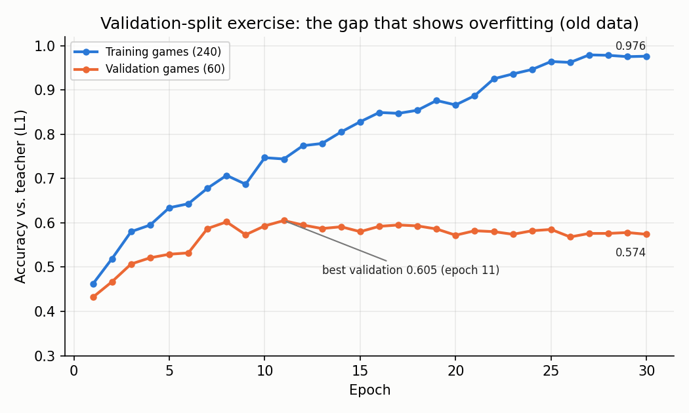
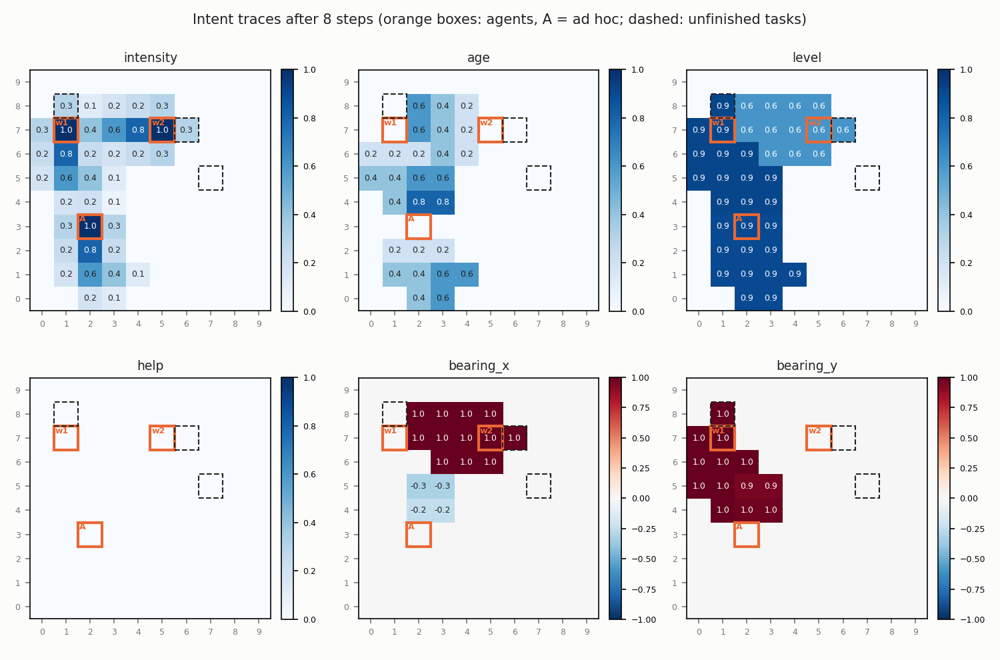
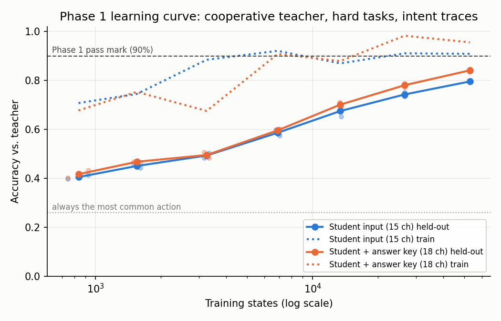
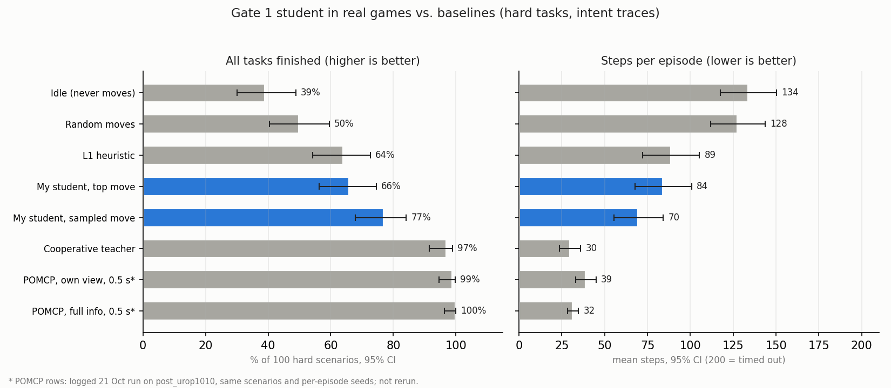

# Meeting note, 6 Nov 2026: back to basics, fixing training, first Gate 1 measurement

## 1. The message in one paragraph
I restarted from `master` to understand every part of the pipeline myself. I went through the basics (problem types,
the training pipeline, overfitting, distribution shift, RL vocabulary, imitation learning and DAgger, evaluation,
ablations and controls) and did hands-on exercises. Using what I learned, I found and fixed the bugs that made
training untrustworthy: training and test conditions differed, the traces were broken, and the student was missing
basic information about itself. Each fix has a test that failed before and passes now (32/32). Then I measured
**Gate 1**: can the student learn the teacher's rule? On the fixed setup, held-out accuracy **keeps rising with more
data** (0.41 → 0.80; 0.84 with the answer key). In October it was stuck at 47 % even with the answer key. It is not
yet at the 90 % pass mark, and the curve says the main limit is now **the amount of data**, not the network or missing
information. In real games, the new student finishes all tasks in **77 %** of hard scenarios (sampling
its moves), against 64 % for L1, 50 % for random moves and 97 % for the teacher.

## 2. The plan I am following: four gates
| Gate | Question | Pass when | Status |
|---|---|---|---|
| 0 | Are training and testing fair? | Same conditions, fixed traces, tests | **Done today** |
| 1 | Can the student learn at all? (positive control) | ≥ 90 % held-out accuracy with the answer key | **Measured: 84 %, still rising** |
| 2 | Do traces help? | Real traces beat shuffled / no-trace students, retrained, several seeds | Next |
| 3 | Beyond the teacher | Improvement from reward, or learning from a planner | Later |

Why this order: a test of traces through a student that cannot learn even with perfect information cannot show
anything (a "broken thermometer"). October's 47 % answer-key result was exactly that situation.

## 3. What I learned (8 lessons)
1. **Problem types:** my task is naturally RL (sparse reward); I turn it into supervised learning by copying a teacher (imitation learning).
2. **Training pipeline:** data → model → loss → training (batch, step, epoch) → testing. Split **by game**, not by step, or near-identical neighbouring steps leak into the validation set.
3. **Overfitting vs. distribution shift:** more data cures the first, not the second.
4. **My CNN:** convolutions share one detector across the grid; the flatten + dense layer has a separate weight per cell (1.6 M of 1.66 M parameters), which is where memorising happens.
5. **RL vocabulary:** state vs. observation, reward, return, value; my problem is a POMDP. Avoidable hidden information (own position, heading) should be in the input; unavoidable hidden information is what traces are for.
6. **The teacher and DAgger:** a privileged teacher knows more than the student; behaviour cloning fails once the student leaves the teacher's path; DAgger labels the states the student reaches.
7. **Evaluation:** all-tasks %, same scenarios for everyone, 95 % error bars (≈ ±10 points with 100 games), paired comparisons, several training seeds.
8. **Ablations and controls:** zeroing inputs at test time is distribution shift, not evidence; retrain each condition; the shuffled control beat real traces in October for an accidental reason (it broke deadlocks).

## 4. Exercises I did by hand
1. **Validation split in `src/utils/train_cnn.py`** (commit `1887e72`): seeded shuffle of the 300 games, 240/60 split by slicing (I fixed an off-by-one in my first loop), separate tensors, and my own `accuracy()` function measured after every epoch.
   - **My prediction:** training rises and flattens near 100 %; validation rises more slowly and catches up later.
   - **Result:** training 0.46 → 0.98; validation rose with it until about epoch 8, then **flattened at ~0.58–0.60** (best 0.605 at epoch 11). My training prediction was right; my validation reasoning was wrong: general patterns are learned first and help on new games immediately, and later gains are memorisation that never transfers.
   - **What I took from it:** "30 epochs" was arbitrary; use early stopping (now used in the Gate 1 script).

   

2. **Reading `reset()`:** the framework's `reset()` restores a snapshot taken when the environment was created, so setting the agent's level afterwards was silently undone. The evaluation code survived only because it calls `copy()` (which takes a new snapshot) before `reset()`.
3. **A failing test:** `tests/test_conditions.py` checks that the training agent matches the evaluation agent. On `master` it failed with `assert 1.0 == 0.9`, and it passes after the fix.

## 5. What was wrong and what changed
My list of problems (`fixes.md`), with what I now understand to be correct:

| # | My point | Corrected understanding | Change |
|---|---|---|---|
| P1 | Distribution shift: trained with full view, tested with partial | Right. Also the level: training used 1.0, evaluation 0.9. The *teacher* may still see everything; what must match is the *student's observation* | `src/utils/scenarios.py` `make_scenario()` applies level 0.9 / view 0.25 before the snapshot; used by data collection **and** evaluation |
| P2 | Flatten treats a task at (1,2) like one at (4,2); "there should be a separate weight for every grid" | **Inverted.** The dense layer already has a separate weight per cell, and that is what lets it memorise. Convolutions are what share weights. The fix is *fewer* position-specific weights (agent-centred input, no big dense layer) | Not changed yet: the learning curve shows data is the bigger limit; this is the next experiment |
| P3 | The agent doesn't know where it is or which way it faces | Right: avoidable hidden information, and a cause of the "load when not facing" deadlocks | +1 own-position plane, +4 heading planes |
| P4 | Rewards are shared, so the agent can't tell its own contribution | Right, but behaviour cloning never uses reward for the policy, so it does not affect Gate 1 | Deferred to Gate 3 (RL) |
| P5 | Teammates and tasks should show levels; use the inputs of `post_urop1010` | Teammate levels are legitimate (the framework gives them, `parameter_knowledge=True`). **Decision: reveal the levels of tasks inside the view** (same information POMCP's own-view mode has). Out-of-view levels stay hidden | Teammate channel = level; task channel = level for visible tasks; fixed trace code ported |

Other bugs fixed (found in the October review, re-verified today with tests):

| Bug | Before | After |
|---|---|---|
| Diffusion (A1) | Spread **only intensity** (+0.3) to neighbours of cells at exactly 1.0; age/level/help not copied; overlaps could reach 1.3 | Only emitted cells spread; neighbours get the **whole trace** with intensity × 0.3; emitted cells never overwritten; help wins overlaps; intensity ≤ 1 |
| Age (A2) | Always 1.0 (no information) | 0 at emission, +0.2 per step |
| Help flicker (A3) | A standing help request was at full strength 1 step in 5 | Refreshed every step |
| Teacher (C2) | L1 ignores task levels and teammates, so its labels never need hidden information | Cooperative teacher (below) |
| Task difficulty (C1) | U(0, 1): only 0.44 tasks per scenario need teamwork | U(0.3, 1.5) |

## 6. What was wrong with the old way of training and evaluating
Beyond the bugs fixed today (Section 5), the October pipeline had problems in how it trained and how it judged
results. Some are fixed now, and some are still open.

### Training
| Problem | Why it mattered | Now |
|---|---|---|
| **The teacher (L1) ignored task levels and teammates** | Its labels never depended on hidden information, so the student had no reason to read traces | Fixed: cooperative teacher |
| **No validation split, fixed 30 epochs** | Overfitting was invisible: my exercise showed 0.98 on training games vs. 0.57 on new ones after 30 epochs | Fixed: split by game, early stopping |
| **Only teacher-driven data (plain behaviour cloning)** | The student never saw how to recover from its own mistakes (covariate shift) | Partly: 20 % random moves; DAgger not yet rerun |
| **The value head was trained alongside the policy** | It added a second loss (weight 0.5) but was never used to choose moves | Fixed in Gate 1 (policy loss only) |
| **The input lacked own position and heading** | Same input, different correct move, so it could never be fully learned (perceptual aliasing) | Fixed: 5 new planes |
| **The large dense layer (1.6 M weights)** | It lets the network memorise positions instead of learning relations | **Open** (next step) |
| **One training seed per student** | You can't tell a real difference from training luck | Partly: 2 seeds in the curve |

### Evaluation
| Problem | Why it mattered | Now |
|---|---|---|
| **The headline figure came from an older script**: each model ran on its own 50 random scenarios, with no error bars | One model, evaluated twice, gave 49 vs 65 steps, as big as the effect being claimed | Fixed: one shared set of 100 scenarios, per-scenario seeds |
| **"Success" meant reward > 0** | It read 94–98 % while 20–24 % of games timed out | Fixed: all-tasks %, plus timeouts |
| **No baselines** | The trained CNN (4.26 reward) was no better than an idle agent (4.19) | Fixed: idle, random, L1, teacher, POMCP |
| **Tasks too easy** (U(0, 1)) | The agent could do 4.5 of 5 tasks alone, so traces had nothing to add | Fixed: U(0.3, 1.5) |
| **Ablation by zeroing inputs at test time** | Zeros are inputs the model never saw (distribution shift), so a drop doesn't prove meaning | Fixed in the plan: Gate 2 retrains each condition |
| **The shuffled control drew a new permutation every step** | The randomness itself broke deadlocks, so the control "won" (69 % vs 53 %) | Open: Gate 2 must use sampling for all, or freeze the permutation per episode |
| **The top-move rule caused deadlocks** | The student repeated a useless move forever | Open: sampling is a workaround (66 % → 77 %); the cause is in the learner |
| **The teacher's competence was assumed** | The student can be no better than its teacher | Fixed: measured against POMCP (Section 8) |
| **Numbers from one-off scripts** that were later lost | They could not be rerun or checked (e.g. the October answer-key test) | Fixed: every number now comes from a repo script and is logged in `results_analysis/LOG.md` |
| **No test set separate from validation** | Choosing on the same games you report inflates the score | **Open** (next step 1) |

## 7. Architecture after the fixes

### Pipeline
```
make_scenario()                      same agent settings for data and evaluation (level 0.9, view 0.25, tasks U(0.3,1.5))
   │
StigmergicLevelForagingEnv           every agent emits a trace each step: decay → emit → diffuse
   │  (trace_mode="intent", local traces, self_features=True)
   ├── student input: 15 × 10 × 10   ──────────────┐
   └── answer key: 3 × 10 × 10 (positive control) ─┤
coop_expert_action()  ── label ────────────────────┤
   │ drives 80 % of steps, random 20 %             │
   ▼                                               ▼
gate1_learning_curve.py:  split by episode → TraceCNN (unchanged) → early stopping on held-out accuracy
```

### Student input (15 channels)
| # | Channel | Value per cell | Why |
|---|---|---|---|
| 0 | teammates | visible teammate's **level**, else 0 | P5: the framework gives teammates' levels; deciding to join a task needs them |
| 1 | tasks | visible unfinished task's **level**, else 0 | P5 decision; out-of-view tasks stay unknown |
| 2 | obstacles | 1 / 0 | unchanged |
| 3–8 | intent traces | intensity, age, level, help, bearing x, bearing y (inside the view only) | the communication channel being studied |
| 9 | visibility mask | 1 inside the view | where the agent is looking |
| 10 | own position | 1 at the agent's cell | P3 |
| 11–14 | heading | one-hot, the whole plane is 1 | P3; a full plane lets every 3×3 filter "know" the heading |

### What a trace looks like now (6 numbers per cell)
`[intensity, age, level, help, bearing_x, bearing_y]`
- **intensity** 1.0 when emitted, −0.2 per step, removed at 0 (5-step trail); a diffused copy is 0.3 × its source.
- **age** 0.0 when emitted, +0.2 per step (capped at 1.0); copies carry the source's age.
- **level** the emitter's level.
- **help** the level deficit `min(task level − own level, 1)` after a failed load, else 0.
- **bearing** unit vector from the emitter to its current target; (0, 0) for the ad hoc agent.
- Example: a level-0.7 teammate heading up toward its task: its cell `[1.0, 0.0, 0.7, 0.0, 0.0, 1.0]`, its neighbours `[0.3, 0.0, 0.7, 0.0, 0.0, 1.0]`; one step later the old cell is `[0.8, 0.2, 0.7, 0, 0, 1]`.



### The teacher: cooperative teacher (`src/utils/coop_expert.py`)
Privileged, hand-written, 97 % all tasks on the hard set. How it decides and how it was evaluated: Section 8.

### The answer key (positive control)
3 extra planes the student never gets in normal training: true level of every unfinished task (in or out of view),
every teammate's level at its cell, and the committed teammate level per task (their targets). With these, the
teacher's choice is a fixed function of the input, so failing with the answer key means a learning problem.

### Network and training
**Training method: behaviour cloning (supervised learning), not DAgger.** The teacher drove 80 % of steps and a random move was played on the other 20 % (noise injection, for some off-path states). Every step was labelled with the teacher's action. The student never drove during collection. DAgger has not been rerun on the fixed setup yet (next steps).

`TraceCNN` unchanged (conv 3×3 ×32 → conv 3×3 ×64 → dense 256 → 5 actions): changing one thing at a time. Adam 1e-3,
batch 128, policy loss only, **early stopping** on held-out accuracy (from exercise 1). 100 held-out games are never
used for training (asserted in code).

## 8. The teacher, and how its competence was measured
Your earlier critique was that the project *assumed* the expert was competent. So before copying it, I measured it.

### How it decides
`src/utils/coop_expert.py`, recomputed from scratch every step (it has no memory):
1. For each unfinished task, add up the levels of the teammates whose current target is that task ("committed").
2. **Skip** the task if the committed level already reaches the task level.
3. **Join** if committed > 0 and committed + 0.9 reaches the level. Cost = distance.
4. **Solo** if 0.9 alone reaches the level. Cost = distance + 3, so helping wins unless it is more than 3 cells further away.
5. Take the cheapest option. If none is feasible, go to the nearest task and wait there for help.
6. Move with A*, press load when facing the target.

It is **privileged**: it reads the true levels of all tasks and the teammates' levels and targets from the simulator.
It does not communicate with teammates; they run fixed L1/L2 rules and never adapt to it.

### Evaluation setup (21 Oct, logged in `results_analysis/LOG.md` on `post_urop1010`)
- **Scenarios:** the shared hard evaluation set: 100 scenarios, seed 2026, task levels U(0.3, 1.5), the same intent-trace wrapper used today. Each episode reseeds the random generators with its scenario index, so every policy faces the same teammate behaviour.
- **Metric:** all tasks finished within 200 steps, with a 95 % confidence interval; reward; steps.
- **Comparison policies:**
  - **floor:** an idle agent and L1;
  - **ceiling candidates:** POMCP (the framework's planner), run fresh for every episode, either with the agent's own view, or with **full information** (full vision plus teammate types, at least what the teacher knows), at 0.02–0.5 s per decision.
- **Paired comparison** with the teacher on the same scenarios, plus a step-by-step replay of every teacher failure (`results_analysis/inspect_teacher.py` on `post_urop1010`).
- The teacher code ported today is the same file, unchanged.

### Why POMCP is the yardstick
- **Idle and L1 are only floors.** Beating them shows the teacher is better than weak policies, not that it is close to the best possible. The truly optimal policy cannot be computed here: the agent sees only part of the world, and the teammates behave in complicated ways.
- **POMCP is the best available stand-in for a ceiling:**
  1. **No hand-written rules.** At every step it simulates many possible futures in the game simulator and picks the move with the most reward. Its notion of "good" comes from reward, so it is an independent judge, not another opinion about the same rules.
  2. **More thinking time makes it stronger.** Running it at several budgets (0.02 → 0.5 s per move) showed it improving toward the ceiling.
  3. **It can be given at least the teacher's information** (the full-information version), which makes losing to it meaningful.
  4. **It already exists** in the framework (`src/reasoning/pomcp.py`).
- *Analogy:* judging a chess player by comparing their moves with a strong chess engine. The engine isn't perfect, but it is strong and independent.
- **What it is good for, and what not:**
  - It **flagged where the teacher gets stuck**: it finished the 3 scenarios the teacher failed, which is why I replayed exactly those.
  - It **cannot judge the teacher's efficiency yet.** At 0.5 s it looks about 10 steps ahead and guesses the rest with random moves, so the teacher was actually faster. A stronger judge (about 2 s per move) is needed for that.
  - The full-information version also knows the teammates' types and simulates them exactly, so it is a slightly generous ceiling.
- **It comes back in Gate 3**, as a candidate teacher whose decisions come from reward rather than rules.

### Results
| Policy | All tasks [95 % CI] | Steps |
|---|---|---|
| Idle | 39 % [30, 49] | 134 |
| L1 | 63 % [53, 72] | 90 |
| **Cooperative teacher** | **97 % [92, 99]** | **30** |
| POMCP, own view, 0.5 s | 99 % [95, 100] | 39 |
| POMCP, full information, 0.1 s | 97 % [92, 99] | 46 |
| POMCP, full information, 0.5 s | 100 % [96, 100] | 32 |

Paired with POMCP full information at 0.5 s:
- **POMCP is more robust.** It never got stuck and finished all 3 scenarios the teacher failed.
- **The teacher is more efficient.** When both finish, POMCP needs 6.4 ± 2.9 more steps, and the teacher is faster in 67 of 97 scenarios.

### Its three failures, and the shared cause
| Scenario | What happened |
|---|---|
| 8 | It skipped a task as "covered" by two committed teammates, but one of them was stuck oscillating between two cells. It then waited 188 steps at a task it could not lift |
| 65 | The same pattern: a committed teammate never arrived, and the teacher waited 193 steps |
| 53 | It and a teammate blocked each other's path, both stepping sideways in lockstep for 189 steps |

**Root cause:** it never checks whether its plan is making progress, and it assumes committed teammates will arrive.
The student's October deadlocks (repeating a useless move) are the same kind of weakness.

### What this means for the project
- **For Gate 1 it is good enough.** Gate 1 asks whether the student can *learn a fixed rule*, flaws included, and 97 % with the fewest steps of any policy is a strong rule to learn.
- **For Gate 3 it is not the final answer.** A student that only copies it inherits the 3 % failure mode. Going beyond it needs reward (RL) or a stronger teacher (POMCP).
- **Today's data is not a competence measure.** In the Gate 1 data, 37 of 2,100 episodes (1.8 %) timed out, but there the teacher drove only 80 % of steps; the other 20 % were random moves added for coverage.

**Caveats on the evaluation**
- One run per configuration, and POMCP's result depends on machine speed.
- The full-information POMCP knows teammate types, which the teacher does not use.
- Only the 3 timeouts were inspected; shorter stalls inside successful episodes were not checked.

## 9. Gate 1 result
2,100 teacher games (69,139 states, 1.8 % timed out); 100 held out; training sets of 25 to 1,600 games, 2 seeds.



| Training states | Student | Student + answer key |
|---|---|---|
| 836 | 0.41 | 0.42 |
| 6,900 | 0.59 | 0.60 |
| 26,504 | 0.74 | 0.78 |
| 52,926 | **0.80** | **0.84** |

**What it says**
- **The student now learns.** Held-out accuracy rises steadily with data, about +5–6 points per doubling, and has not levelled off. Always picking the most common action scores 0.26.
- **Data is the main limit.** Even with perfect information (the answer key), the student is at 0.84, and it improves as data grows.
- **Missing information is a smaller limit:** the answer key adds about 4–5 points at the largest sizes.
- **Gate 1 is not passed yet** (needs 0.90).

### In real games: my student vs. the baselines
Accuracy only measures copying on the teacher's states. So I also let the student **play**.
- **Setup:** the 100 hard evaluation scenarios, one game each, seeded per scenario exactly as the teacher evaluation.
- **Student:** the 15-channel student, trained on all 2,000 training games (66k states; held-out accuracy 0.803).
- **Two ways to pick a move:** the top-scoring move ("argmax"), or a move drawn at random with the model's probabilities ("sampling").



| Policy | All tasks [95 % CI] | Mean steps | Timeouts |
|---|---|---|---|
| Idle | 39 % [30, 49] | 134 | |
| Random | 50 % [40, 60] | 128 | |
| L1 | 64 % [54, 73] | 89 | |
| **My student, top move** | **66 % [56, 75]** | 84 | 34 |
| **My student, sampled move** | **77 % [68, 84]** | 70 | 23 |
| Cooperative teacher | 97 % [92, 99] | 30 | 3 |
| POMCP own view / full info, 0.5 s (logged) | 99 % / 100 % | 39 / 32 | |

**What it shows**
- **Sampling clearly beats random.** On the same scenarios it finished 32 that random didn't, and random finished only 5 it didn't. It also beats L1 (15 vs 2).
- **The top-move student is only level with L1,** and gets stuck far more (34 timeouts). It is the October deadlock again: when unsure, it repeats the same move forever. Sampling breaks the loop (17 vs 6 scenarios against argmax).
- **It is still far from the teacher.** The teacher finished 23 scenarios the sampled student did not, and it needs less than half the steps.
- **A side result:** the sampled student finished all 3 scenarios the teacher failed in this run (8, 53, 89). That is not intelligence: random sampling simply escapes the same stuck loop.
- **Improvement over October:** the October **DAgger** student reached 53 % (51 % top move, 65 % sampled), on code with the old bugs. Today's student is plain **behaviour cloning** on the fixed setup. The comparison mixes many changes, including the training method, so treat it as direction, not size.

**Caveats**
- One training seed for the playing student.
- Idle, L1 and the teacher **nearly** reproduce the logged 21 Oct numbers (idle 39 % = 39 %; L1 64 % vs 63 %; teacher 97 % = 97 %, 29.8 vs 30.3 steps). However, the teacher failed in scenario 89 here instead of 65, so the runs are not bit-identical; the source is unknown.
- POMCP rows are the logged October runs, not rerun.

**Honest caveats (learning curve)**
- 2 seeds and one held-out set; differences under ~2 points are within noise.
- The 100 held-out games also chose the early-stopping epoch, so they act as a **validation** set and the numbers are slightly optimistic. A separate test set, never used for decisions, is the clean fix.
- I can't say *which* fix caused the jump from October's flat 47 %: several things changed at once (fixed traces, visible levels, own position/heading, teacher-driven data, more data).
- Accuracy measures copying, not playing; the game results above are the check, for one trained student.
- Whether the curve reaches 0.90 is an extrapolation until measured.

## 10. Detailed next steps
Each step says why it comes next, what I would do, and what result would change my plan.

1. **Make the Gate 1 number honest: add a test set.**
   - *Why:* the 100 held-out games also chose the early-stopping epoch, so the reported accuracy is slightly optimistic (Lesson 7).
   - *Do:* split the games three ways (training / validation / test); report only the test score.
   - *Effort:* small, a change to `gate1_learning_curve.py`.
2. **Extend the learning curve with more data.**
   - *Why:* the curve is still rising at 53k states, about +5–6 points per doubling.
   - *Do:* collect 4–8× more teacher games (about 1 minute per 500 games) and train at 100k–400k states, with 3 seeds.
   - *Decision:* answer-key curve reaches 0.90 ⇒ Gate 1 passed. It flattens below 0.90 ⇒ go to step 3.
3. **Fix the network (my P2, corrected).**
   - *Why:* the dense layer has a separate weight per cell (1.6 M parameters), so "a task 2 cells to my right" must be learned separately at every position.
   - *Do:* compare (a) an agent-centred input, where the grid is shifted so the agent is always in the middle, and (b) a network without the large dense layer. Same data, same split, 3 seeds.
   - *Decision:* whichever reaches 0.90 with the least data becomes the student.
4. **Play games, not just accuracy.**
   - *Why:* accuracy measures copying on the teacher's states; playing measures what the student actually does, including its own mistakes (Lesson 6).
   - *Do:* run the best students on the 100 hard evaluation scenarios, with both argmax and sampled moves, against the idle / L1 / teacher baselines.
5. **Gate 2, once Gate 1 passes: do traces help?**
   - *Do:* train three students with the same data, network and seeds: real traces, shuffled traces (meaning destroyed), and no traces. Evaluate them in paired games, with sampling to avoid the October deadlock artefact.
   - *Decision:* real must beat shuffled by more than the error bars. Also a trace-by-trace version (help only, bearing only).
6. **DAgger on the new setup.**
   - *Why:* behaviour cloning only shows the teacher's states; DAgger adds the states the student's own mistakes lead to.
   - *Do:* reuse `train_dagger.py` from `post_urop1010` with the 15-channel input, after steps 1–3.
7. **Gate 3: beyond the teacher.**
   - *Options:* (a) RL fine-tuning of the cloned student, using my P4 idea (an own-contribution reward next to the team reward) to make credit assignment easier; (b) POMCP as the teacher (Expert Iteration), since it is more robust; (c) add a progress check to the teacher (needs all data regenerated).

## 11. Questions to ask, and why each matters
**About the setup**
1. *Is revealing the levels of tasks inside the agent's view acceptable?* It matches POMCP's own-view setting, and it narrows what traces are for to tasks out of view and teammates' intentions. If not acceptable, I go back to hidden levels, and traces must carry level information again.
2. *Are 2 teammates, 5 tasks and a 10×10 grid enough, or should difficulty scale (more teammates, larger grid)?* More teammates make coordination, and so traces, matter more.

**About Gate 1**
3. *Is "≥ 90 % held-out accuracy with the answer key" the right bar before testing traces?* Is 90 % too strict, given that the teacher itself only finishes 97 % of games?
4. *Should I keep increasing data, or change the network first?* The curve says data; agent-centred input may get there faster.

**About traces (Gate 2)**
5. *Must trace meaning be learned by the student, or may I design it?* Designed meaning, for example a planner that turns a help deficit into a task-level estimate, is much easier to show working, but it changes the research question.
6. *What would count as a convincing trace result?* For example: real > shuffled > none in closed-loop games, with paired statistics over several seeds.

**About the teacher and Gate 3**
7. *Is the cooperative teacher acceptable as the expert, given its measured 3 % failure mode? Or should I fix it with a progress check, or switch to POMCP as the teacher?*
8. *For going beyond the teacher: RL fine-tuning (with the own-contribution reward), or POMCP-guided learning?* Which fits the scope of a UROP?

**About scope**
9. *What is the expected deliverable and deadline for this term:* Gate 1 passed, Gate 2 answered, or a written report of Gates 0–1?

## Files changed today
- **Fixes:** `src/utils/scenarios.py` (new), `src/utils/collect_data.py`, `src/utils/evaluation.py`, `src/communication/traces.py`, `src/envs/StigmergicLevelForagingEnv.py`, `src/utils/tensor_convert.py` (own position, heading, visible levels), `src/utils/coop_expert.py`, `src/utils/answer_key.py` (new).
- **Tests:** `tests/test_conditions.py`, `tests/test_student_input.py`, plus `tests/test_traces.py`, `tests/test_diffusion.py`, `tests/test_stigmergic_env.py` and `tests/test_coop_expert.py` (ported from `post_urop1010`): 32/32 pass.
- **Experiment:** `results_analysis/gate1_learning_curve.py`, `results_analysis/evaluate_gate1.py` (games vs. baselines; results in `results_analysis/Results/gate1_eval/`, student weights `src/models/gate1_student_intent_tasks0.3-1.5.pth`), `results_analysis/plot_gate0_figures.py`, `results_analysis/LOG.md`, `results_analysis/Results/gate1_learning_curve.csv`, `results_analysis/Results/gate0/`, and four plots in `results_analysis/Plots/`.
